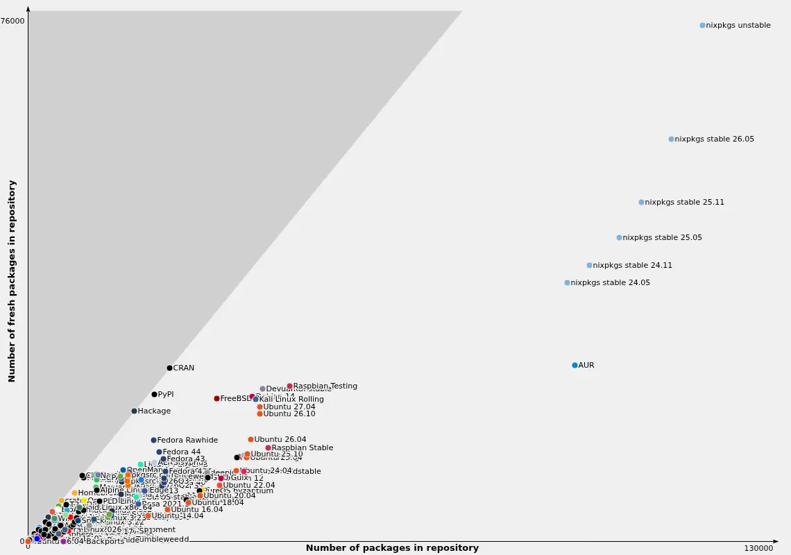
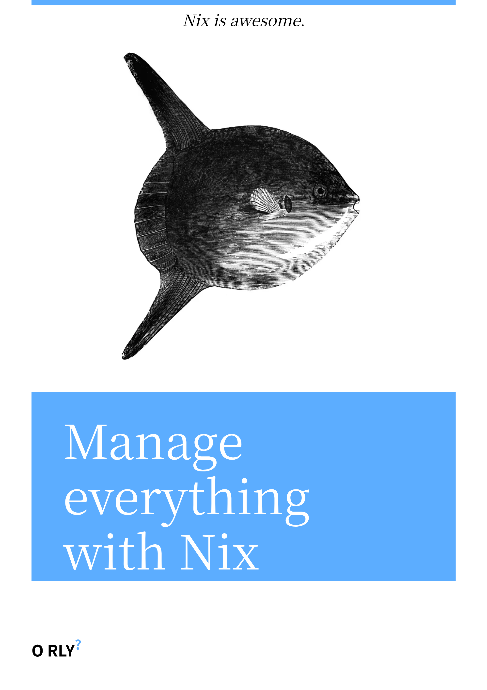

🎄この記事は bitA Tech Blog Advent Calendar 2026 の3日目の記事です。

2026の夏ごろからNixOSとHome Managerを使い始めました。
この記事では、Nixを始める前に持っていた誤解と実際にどうだったかを書きます。Nix利用のハードルを下げる一助になれば幸いです。

筆者のdotfiles
@[card](https://github.com/WATA-Haru/dotfiles)

## 要約

- NixOS を入れなくてもNixは使い始められる
- AIがあるのでハードルが下がった結果、個人用dotfilesは2週間程度で移行できた
- パッケージがなくて困ることがほぼない

## そもそもNixとは

@[card](https://nixos.org/)

純粋関数型パッケージマネージャです。
Nixではソースコード・依存パッケージ・ビルド手順などを記述した「導出」から、成果物を置くNix storeのパスが決まります。パスには、導出の内容から計算されたhash値が含まれます。

```sh
/nix/store/zyd352l717savmg98vj8v1b57iqc8gbi-yazi-26.9.1
```

パッケージはローカルでビルドされる他に、信頼できるバイナリキャッシュから取得する方法があります。

このビルドシステムの利点は2つあります。
第一に、依存関係地獄を回避できる点です。異なるバージョンや異なる依存関係でビルドされたパッケージを別々のパスに共存させることができるので、AがライブラリPの v1 を、BがPの v2 を必要とする場合でも、Pのv1とv2を別々のパスに共存させられます。そのため、Bを更新しても、Aが利用するPのv1は上書きされません。

第二に、ビルド依存関係の宣言漏れを防げる点です。これにより、ビルド環境の違いによる失敗を防ぎやすくなります。Nixのビルドプロセスでは明示的に宣言されたリソースのみがビルドに使用されます。たとえば、ライブラリの依存関係を書き忘れていた場合に、あるユーザ環境ではあらかじめパッケージが入っていたのでビルドが成功するが、別のユーザの環境では失敗することがあります。Nixではこういった宣言漏れをビルド時に発見できます。

このように、Nix特有の性質によって、環境構築の再現性を高めることができます。
Nixで使われるビルドについてより詳しく知りたい方はこちらをご覧ください。
@[card](https://nixos.org/guides/how-nix-works/)

Nixの使い方についてはこの記事で解説しませんので、気になる方は以下をご参照ください。
@[card](https://zenn.dev/asa1984/books/nix-introduction)

## 誤解1: ハードルが高すぎる

Nixを理解するのは難しいですが、Nixを詳しく知らなくとも、AIがあれば利益を享受できます。
実際に、全くの初心者である筆者でもchezmoiで管理していたdotfilesをHome Managerに移行し、2週間程度で開発できるレベルまで到達できました。

dotfiles移行にあたって、Home Managerで以下の機能は問題なく使えました。

- `dotfiles`においたファイルを元に `~/.config`以下の設定を管理する
- OSやホストごとに設定を変える

個人的には `home.packages` に必要なパッケージを書いておけば、aptなどを呼ぶインストールスクリプトを書かずに済むのが非常に助かりました。

## 誤解2: NixOSを入れなければいけない。Nixですべてを管理する必要がある

Nixと調べるとNixOSが出てくるので、NixOSを入れてOSごと変える必要があると思っていましたが、そんなことはありませんでした。

小さく始める順に整理すると、Nixが生きる箇所は以下の4つに分けられます。

1. 使い捨ての環境でパッケージを動かす
2. プロジェクトごとの開発環境を定義する
3. ホーム環境を管理する
4. システムレベルの管理をする(NixOS, macOS)

### 1. 使い捨ての環境でパッケージを動かす

`nix-shell`を使えば、一時的なシェルでパッケージを試せます。ご自分の環境でNixを[インストール](https://nix.dev/install-nix)していただき、以下を実行するだけで気軽にパッケージを試せます。

```sh
nix-shell -p cowsay
```

<!-- textlint-disable ja-technical-writing/no-doubled-joshi -->筆者の環境で試したら以下のような出力になりました。`nix-shell`上だけでcowsayが実行されることがわかります。<!-- textlint-enable ja-technical-writing/no-doubled-joshi -->
このように、パッケージを気軽に試したい場合や環境を汚したくない場合に向いています。

```sh
$ cowsay
Command 'cowsay' not found, but can be installed with:
sudo apt install cowsay

$ nix-shell -p cowsay
[nix-shell]$ cowsay "hello"
 _______
< hello >
 -------
        \   ^__^
         \  (oo)\_______
            (__)\       )\/\
                ||----w |
                ||     ||

[nix-shell]$ exit

$ cowsay
Command 'cowsay' not found, but can be installed with:
sudo apt install cowsay
```

参考: [Nix tutorial](https://nix.dev/tutorials/first-steps/ad-hoc-shell-environments)

### 2. プロジェクトごとの開発環境を定義する

Nixではプロジェクトごとに言語やformatter, linter, lspをまとめて定義できます。
flake[^1]を使う場合は、`flake.nix`の`devShells`に開発環境を定義します。生成された`flake.lock`をGitで管理すれば、同じNixpkgsのリビジョンを使いやすくなり、環境の再現が容易になります。

各言語別の環境にはdev-templatesが参考になります。
@[card](https://github.com/the-nix-way/dev-templates)

これにdirenvを組み合わせると更に便利です。
`.envrc`に`use flake`を書いて許可すると、`cd`した際に開発環境を自動で読み込めます。

```.envrc
use flake
```

プロジェクトごとに必要な言語やツールをNixの仕組みで用意できて非常に便利です。

### 3. ホーム環境を管理する

Home Managerでユーザの開発環境を宣言的に管理できます。
個人的には、一般的なdotfilesや開発ツールの管理であればNixOSまでいれなくとも、Home Managerだけで十分だと考えています。また、Home Managerを使う際にNixOSを入れる必要はなく、Ubuntu + Home Managerのような構成でも全く問題なく使えます。

Home Managerでは`.nix`ファイルから設定をビルドしたり、`dotfiles`配下のファイルからシンボリックリンクを貼ったりする作業をshellスクリプトなしで設定できます。

具体例を見ていきます。筆者のdotfilesからNeovimの設定を抜粋します。
下記のコードのようにパッケージの基本設定と依存パッケージがあればそれを記載します。

<!-- markdownlint-disable-next-line MD034 -->
https://github.com/WATA-Haru/dotfiles/blob/633c3cc7ac00c1f5d20eb1216303f141e60f4565/modules/neovim.nix#L7-L19

その後、Home Managerが指定したパスにリンクを作成し、Neovimはその設定を読みます。リンク先の `../config/nvim`はNix用に書き換えたものではない普通のNeovimの設定ファイルです。

<!-- markdownlint-disable-next-line MD034 -->
https://github.com/WATA-Haru/dotfiles/blob/633c3cc7ac00c1f5d20eb1216303f141e60f4565/modules/neovim.nix#L37-L38

上記のように、インストールスクリプトなしでツールがインストールでき、設定ファイルの置き場所も柔軟に決められます。詳しくはHome Managerのマニュアルなどをご覧ください。

@[card](https://nix-community.github.io/home-manager/)

### 4. システムレベルの管理をする(NixOS, macOS)

NixOSもしくはnix-darwinを使います。NixOSとnix-darwinは別のツールで、NixOSはLinuxディストリビューション全体を宣言的に構成します。一方で、nix-darwinは macOSの設定を宣言的に管理するものです。nix-darwinでは、キーボード設定、電源設定など手動で変えていたものを宣言的に管理できるようになります。

筆者はmacOSを持っていないのでnix-darwinは使っていないのですが、自宅のminiPCにNixOSを入れてネットワークの設定やsshの設定などをしています。仮に何らかの理由でminiPCを初期化することになっても、NixOSの設定をコマンドで再現・反映しやすくなります。

参考
@[card](https://nixos.org/)

@[card](https://github.com/nix-darwin/nix-darwin)

## 誤解3: パッケージがなくて困る

Repology の11/08時点の集計では、Nixpkgs は非常に大きなパッケージコレクションであることがわかります。非常に多くのパッケージがあるので、筆者も日常使いで困ることはありませんでした。



[Repology](https://repology.org/repositories/graphs)（2026/11/08 時点）

## 終わりに

<!-- textlint-disable ja-technical-writing/ja-no-weak-phrase -->結論、AIがあるのでNixを動かして利益を得る分にはハードルが低いと思います。<!-- textlint-enable ja-technical-writing/ja-no-weak-phrase -->
筆者としては `home.packages` に必要なパッケージを書いておけばインストールスクリプトを書かずに済む体験が良く、環境構築の体験が格段に変わりました。もうNixから離れられません。

Nixですべてを管理していきましょう！


[^1]: flakeはexperimentalな機能です。experimentalではあるものの、実用的なので多くのプロジェクトで使われています。 [flakeの公式説明](https://nix.dev/concepts/flakes)
