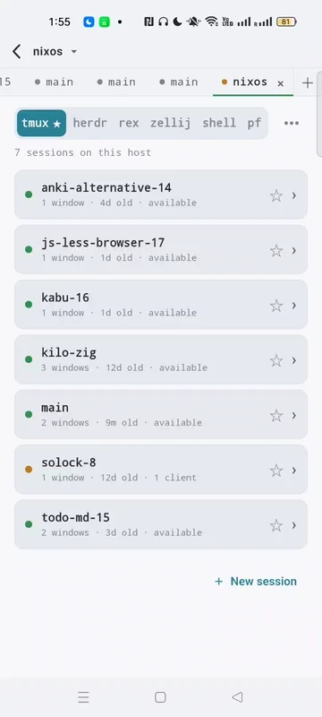
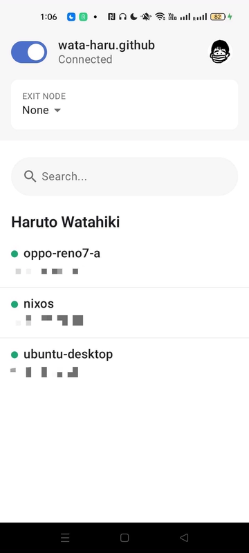
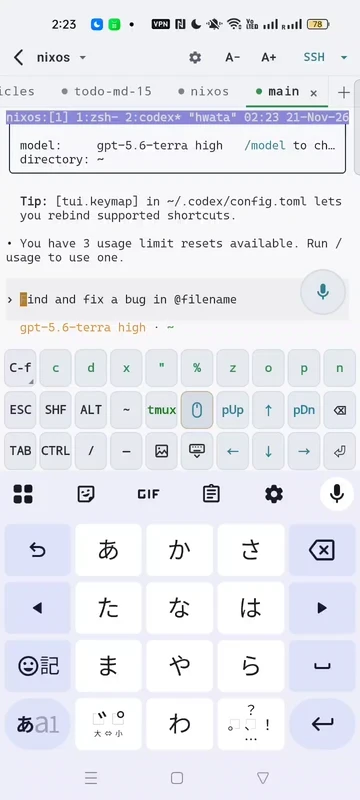
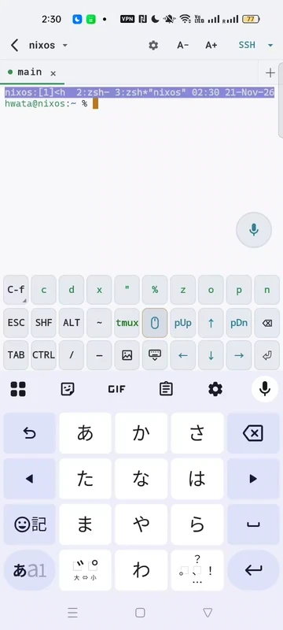
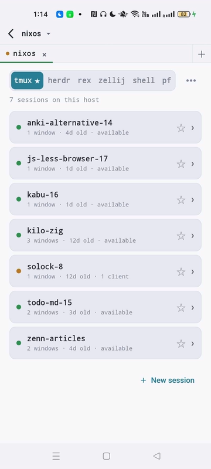

🎄この記事は bitA Tech Blog Advent Calendar 2026 の2日目の記事です。

2026年は私のスマホ開発元年㊗️でした。スマホから開発する際に、[Tailscale](https://tailscale.com/docs/how-to/quickstart)と[TermRover](https://termrover.sh/)が便利すぎたので紹介します。

## Demo

## 前提条件

筆者は家に常時稼働しているミニPCがあり、そこにtmuxのセッションを複数立ち上げてAIと対話しながら開発しています。スマホから操作する際はTermRoverというアプリを使ってtmuxを操作しています。

以下が前提条件です。

1. 開発用端末を常時稼働させていること
2. ターミナルで開発をしていること
3. 開発用端末にSSHできること

[tmux](https://tmux.app/)、[Herdr](https://herdr.dev/)、[Rex](https://www.superlogical.com/rex/docs/installation)、[Zellij](https://zellij.dev/)のいずれかを使用していると、TermRoverの恩恵をより受けることができます。もちろん通常のシェルも使えます。
<!-- textlint-disable ja-technical-writing/ja-no-weak-phrase -->
「[Orca](https://orca.dev/)と、Orcaのスマホアプリでよいのではないか」と思われた方もいらっしゃると思います。しかし、筆者はターミナルで開発しており、常時稼働のマシンがGUIなしのNixOSの、ためこの構成になりました。
<!-- textlint-enable ja-technical-writing/ja-no-weak-phrase -->

## Tailscale

イメージ的には、自宅の開発マシンとスマートフォンを簡単につなぐことができるVPNのようなものだと思っていただければ良いです。

@[card](https://tailscale.com/docs/how-to/quickstart)

Tailscaleを使えば、手動でのポート開放や固定グローバルIPなしで自宅の開発マシンと接続できます。MagicDNSという機能があり、有効にしておけば`nixos.tail0000.ts.net`のようなMagicDNS名でアクセスできるようになります。これにより、SSHの設定にIPアドレスを記載する必要がなくなります。

Tailscaleの導入手順は以下のようになります。

1. Tailscaleをスマートフォンと開発端末にインストールする。
2. 両方の端末でログインを済ませる。各端末にはTailscale IPアドレスが割り振られる。

これでTailscaleによる端末間接続の準備は完了です。詳しい設定は公式ドキュメントをご覧ください。
@[card](https://tailscale.com/docs/how-to/quickstart)

ログインが成功すると以下のようにTailscaleネットワーク上の端末一覧が表示されます。

通常のSSHを利用する場合は、開発端末側でSSHサーバーと認証を設定します。[Tailscale SSH](https://tailscale.com/docs/features/tailscale-ssh)を利用する方法もあります。

## TermRover

@[card](https://termrover.sh/)

TermRoverはiOS・Android向けのSSHターミナルです。SSH先のtmuxをスマートフォンから使うことができます。もちろん、通常のSSHターミナルとして使えるほか、[Rex](https://www.superlogical.com/rex/docs/installation)、[Zellij](https://zellij.dev/)と組み合わせても使えます。

今回は筆者が使っているtmuxで紹介します。

### 入力機能  🇯🇵 & 🎤

日本語入力は当然に見えますが、意外にも日本語入力をサポートしていないターミナルアプリはあります。その点、TermRoverでは問題なく日本語入力ができます。

※デモには、音声認識が意図どおり入力できていない部分があります。原因は特定できておらず、ほかの端末での動作は未検証です。

### ターミナルの分割

画面に`prefix`操作用のキーが表示されるため、ペイン分割や新しいウィンドウの作成ができます。

以下のように、tmuxセッションの一覧から、接続するセッションを選べて便利です。

## 終わりに

今年はTailscaleとTermRoverでスマホ開発元年㊗️になりました。
興味があったらぜひ試してみてください。読んでいただきありがとうございました！
