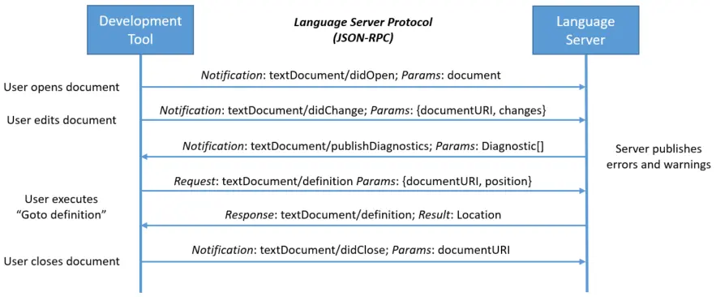

🎄この記事は bitA Tech Blog Advent Calendar 2026の4日目の記事です。

VS CodeやJetBrains製のエディタではインポートしたコードにジャンプしたり、HTMLを編集していて`<d`まで打つと`<div>`が変換候補に出たりします。これらはもはや当たり前の機能ですが、裏ではLanguage ServerやLSP Clientが動いています。

本記事ではLSP関連のプラグインとそれぞれの役割を整理します。

## 記事に書くこと

- Language ServerとLSP Clientの境界線の整理
- それぞれをサポートするプラグインの詳細
- 自分が使っている構成

## 記事に書かないこと

- 個々のLSPの設定方法
- Language Serverの動作原理の詳細
- LSP Configの詳細

## 前提

LSPとはLanguage Server Protocolの略称です。
以下で説明するLanguage ServerとLSP Clientは、このLSPのルールに則ってやり取りします。

### エディタがLanguage Serverとやり取りする仕組み

登場するツールを整理します。

| ツール             | 役割                             |
| --------------- | ------------------------------ |
| Language Server | コードを解析し、補完・構文エラーの検知・関数定義の把握を行う |
| LSP Client      | エディタ側でLanguage Serverと通信するツール  |
| LSP Config      | LSP Clientの設定                  |

まずはLanguage Serverです。Language Serverはソースコードを解析するツールです。
解析により、コード補完・エラー表示・コードの定義場所の把握をします。エディタとは別プロセスで動きます。

LSP ClientはLanguage Serverとやり取りするツールです。エディタがファイルを編集した際や関数の定義場所の参照要求を送った際にイベントを検知してLanguage Server側にイベントと対象ファイルの通知をします。

LSPはLanguage Server Protocolの略称でLanguage ServerとLSP Client側のやり取りを規格化したものです。

これらの関係は以下の図がわかりやすいです。左のDevelopment Toolの四角がLSP Clientだと考えてください。


引用元: [Microsoft What is the Language Server Protocol?](https://microsoft.github.io/language-server-protocol/overviews/lsp/overview/)

LSPクライアントとLanguage Serverのやりとりは例を見るとわかりやすいです。[Microsoft 言語サーバープロトコル](https://microsoft.github.io/language-server-protocol/overviews/lsp/overview/)のドキュメントによると、関数の定義場所にジャンプするGo Definitionは以下のようにやり取りします。

下記のコードはLSP Clientからuse.cppの`line: 3, character: 12`にある関数の定義元の参照要求をしています。

```json
{
    "jsonrpc": "2.0",
    "id" : 1,
    "method": "textDocument/definition",
    "params": {
        "textDocument": {
            "uri": "file:///p%3A/mseng/VSCode/Playgrounds/cpp/use.cpp"
        },
        "position": {
            "line": 3,
            "character": 12
        }
    }
}
```

引用元: [Microsoft 言語サーバープロトコル](https://microsoft.github.io/language-server-protocol/overviews/lsp/overview/)

応答は以下のようになります。`provide.cpp`にある`line: 0, character: 4`から始まって`line: 0, character: 11`で終わる関数を返しています。

```json
{
    "jsonrpc": "2.0",
    "id": "1",
    "result": {
        "uri": "file:///p%3A/mseng/VSCode/Playgrounds/cpp/provide.cpp",
        "range": {
            "start": {
                "line": 0,
                "character": 4
            },
            "end": {
                "line": 0,
                "character": 11
            }
        }
    }
}
```

引用元: [Microsoft 言語サーバープロトコル](https://microsoft.github.io/language-server-protocol/overviews/lsp/overview/)

このように、Language ServerとLSP ClientはLSPに従ってやり取りをしています。VimでLSPの機能を使う場合は、エディタ側にLSP Clientを導入し、ユーザの環境にLanguage Serverをインストールする必要があります。

### LSP Configとは

LSP Configは、LSP ClientがLanguage Serverを起動・接続するための設定です。対象の`filetype`やワークスペースのルートディレクトリ、Language Server側へ渡す設定を指定します。

例えば、LSP Configによって`.git`がある階層をルートディレクトリと認識させたり、`dist/`をLanguage Serverの読み取り対象から外したりといったワークスペースの設定ができます。

言語別の設定をする場合もあります。例えば、Vue.jsで使う`.vue`ファイルを編集する場合を考えます。`.vue`を編集する場合、`<script>`ではTypeScriptまたはJavaScriptのLanguage Serverとやり取りしたいです。他にも`<style>`ではCSS用のLanguage Serverを、`<template>`ではVueでサポートされるHTMLの構文を解釈するLanguage Serverと通信してほしいです。
しかし、Language Serverはデフォルトで`<script>`内部だけTypeScriptで読み取るというような複雑な挙動をしないため、こういった設定をするためにはLSP Configが必要になります。

例えば、筆者の設定ファイルでは`vtsls.lua`という設定ファイルを定義して設定を書いています。
<!-- markdownlint-disable-next-line MD034 -->
https://github.com/WATA-Haru/dotfiles/blob/main/dot_config/nvim/lua/lsp/vtsls.lua#L39-L56

### ここまでのまとめ
<!-- textlint-disable -->
- Language Serverではプログラムを読み取って解析します。解析して関数の定義場所や構文ミスを把握します。
- エディタ側ではLanguage Serverとやり取りするためのLSP Clientを導入することで通信できるようになります。
- Language ServerがLSP Clientとやり取りするための共通規格がLSPです。
- LSP Clientをユーザーの意図通りに動かすためにLSP Configを使います。
<!-- textlint-enable -->
## VimとLSP周りのエコシステムの分類

VimのLSPを正しく動かすには、Language Serverのインストール・LSP Client・LSP Configが必要です。

|ツール|役割|
|---------------|------------------------------|
|Language Server|コードを解析し、補完・構文エラーの検知・関数定義の把握を行う|
|LSP Client|エディタ側でLanguage Serverと通信するツール|
|LSP Config|LSP Clientの設定|

以下では、有名なプラグインの責務を分離して考えます。プラグインでこれらの責務を綺麗に分けているものと分けていないものがあるので混乱することがあります。いくつか具体例を見ていきます。

### 1. Language Serverの導入方法

Language ServerをVim内部で管理する方法と、Vim外部に自分でインストールする方法の2つがあります。

#### Vim内で管理する

プラグイン側でLanguage Serverのインストールをする方法です。代表的なものとしてNeovimでは[mason.nvim](https://github.com/mason-org/mason.nvim)、Vimでは[vim-lsp-settings](https://github.com/mattn/vim-lsp-settings)が挙げられます。

例えば、mason.nvimだとLanguage Serverを含むパッケージがNeovimのデータディレクトリに保存されます。その後、Mason側でPATHの追加や、実行ファイルをMasonの`bin`ディレクトリに集める処理が行われます。[^1] ユーザーはLanguage Serverの導入やPATH設定を手動で管理する必要がありません。

[^1]: <https://github.com/mason-org/mason.nvim/blob/main/doc/mason.txt#L18-L22>

#### Vim外部で管理する

自分でLanguage Serverをインストールしてパスを通します。直接インストールしても良いですが、Nixやmiseで管理すると便利です。

### 2. LSP Clientの導入方法

Neovimでは標準でLSP Clientが入っています。
@[card](https://neovim.io/doc/user/lsp/)

Vimには入っていないので、別途[vim-lsp](https://github.com/prabirshrestha/vim-lsp)や[ALE](https://github.com/dense-analysis/ale)で設定します。

### 3. LSP Config

代表的なものを列挙します。

- Neovim v0.11からの[内蔵LSP Config](https://neovim.io/doc/user/news-0.11/#_lsp)
- [nvim-lspconfig](https://github.com/neovim/nvim-lspconfig)
- [mason-lspconfig.nvim](https://github.com/mason-org/mason-lspconfig.nvim)
- [ALE](https://github.com/dense-analysis/ale)
- [vim-lsp-settings](https://github.com/mattn/vim-lsp-settings)

Neovimではv0.11から内蔵LSP Configが登場したので、LSP Configの設定もプラグイン無しでできます。これらは`vim.lsp.config()`と`vim.lsp.enable()`で有効にできます。

nvim-lspconfigはNeovimのv0.11以前からLSP周りの設定を支えてきたプラグインです。内蔵LSPは出ましたが、nvim-lspconfig自体は非推奨ではありません。かつての`require('lspconfig')`や`<server>.setup()`は非推奨になりましたが、Language Serverごとの設定に関しては現役です。

ALEはこの中ではかなり変わっています。ALEはもともと非同期Lintのためのプラグインでした。現在ではLSP Clientの機能も内蔵していて、ALEをVimのLSP Clientとして使いつつ設定もALEで書くことができます。

`vim-lsp-settings` は `vim-lsp` 向けの導入支援プラグインです。LSP Clientは `vim-lsp` であり、公式READMEでも両方のプラグインを導入するよう案内されています。vim-lsp-settingsは、Language Serverインストールの仕組みやLSP Config設定の仕組みを提供します。

## ツール別の分類表

有名なツールを分類すると以下のようになります。

### Neovim

|ツール名|Language Server|LSP Client|LSP Config|備考|
|-------------------------------------------------------------------------|---------------|----------|----------|-----------------------------|
|[mason.nvim](https://github.com/mason-org/mason.nvim)|○|×|×|LSP以外にFormatter・Linterなども管理可能|
|手動でのLanguage Server導入|○|×|×|mise、Nix、OSのパッケージマネージャーなどで管理|
|内蔵LSP Client|×|○|×|Neovimに標準搭載|
|内蔵LSP Config|×|×|○|Neovim 0.11以降|
|[nvim-lspconfig](https://github.com/neovim/nvim-lspconfig)|×|×|○|各Language Server向けの既定設定を提供|
|[mason-lspconfig.nvim](https://github.com/mason-org/mason-lspconfig.nvim)|×|×|○|Masonとnvim-lspconfigの橋渡し|
|[ALE](https://github.com/dense-analysis/ale)|×|○|○|Linter・Formatterとしても使える|

### Vim

|ツール名|Language Server|LSP Client|LSP Config|備考|
|-----------------------------------------------------------------------|---------------|----------|----------|--------------------------------------------------------------|
|[vim-lsp](https://github.com/prabirshrestha/vim-lsp)|×|○|○||
|[vim-lsp-settings](https://github.com/mattn/vim-lsp-settings) + vim-lsp|○|○|○|LSP Clientにはvim-lspを使用、Language Server導入と既定設定はvim-lsp-settings|
|[ALE](https://github.com/dense-analysis/ale)|×|○|○|vim-lspは不要|

筆者が実際に使ったことがある構成は次の3つです。

- Neovim + mason.nvim + nvim-lspconfig + mason-lspconfig.nvim
- Neovim + 手動導入したLanguage Server +  内蔵LSP Config
- Vim + ALE + 手動導入したLanguage Server

先の分類表に分けると以下になります。

|エディタ|Language Server|LSP Client|LSP Config|備考|
|------|---------------|----------|-------------------------------------|-------------|
|Neovim|mason.nvim|内蔵LSP|nvim-lspconfig + mason-lspconfig.nvim||
|Neovim|手動|内蔵LSP|内蔵LSP Config|プラグインなしでも設定可能|
|Vim|手動|ALE|ALE||

## 終わりに

VimではLSP ConfigとLanguage ServerとLSPについて意識するので最初は境界が分からずに混乱しました。この記事が理解の一助になれば幸いです。
