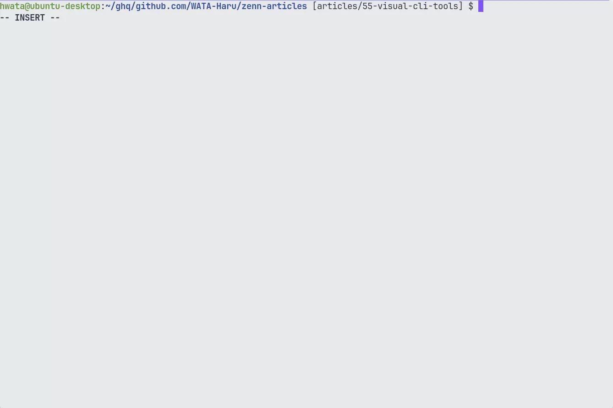
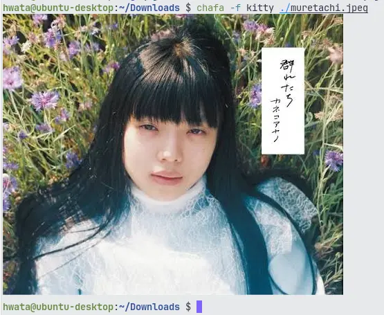
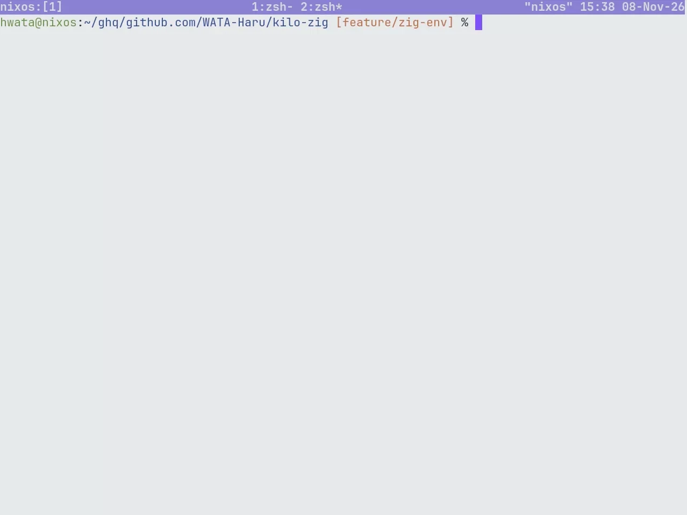
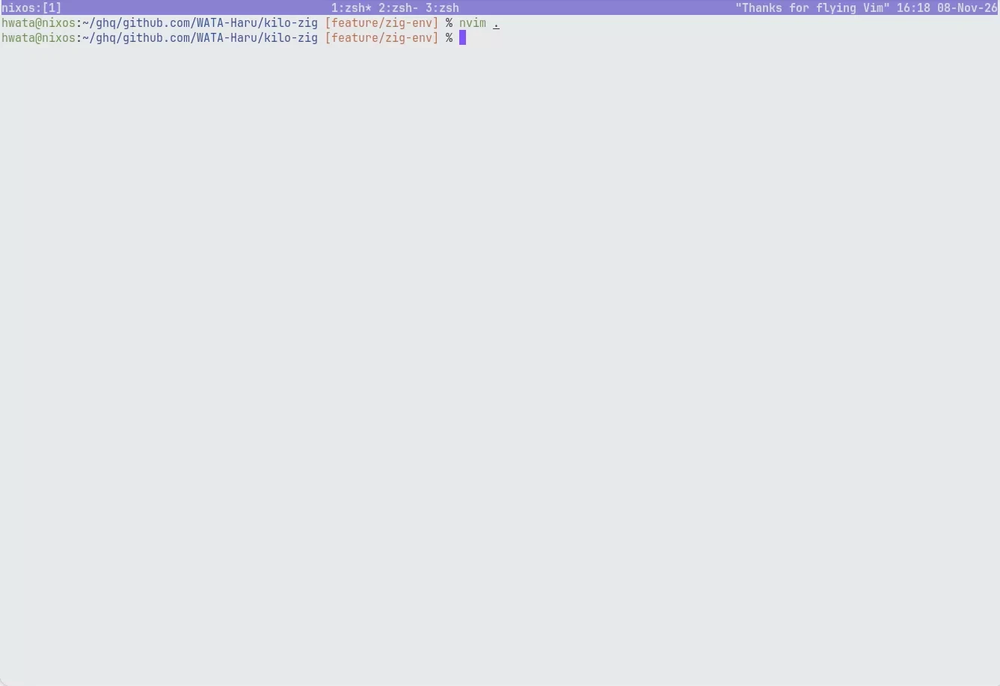
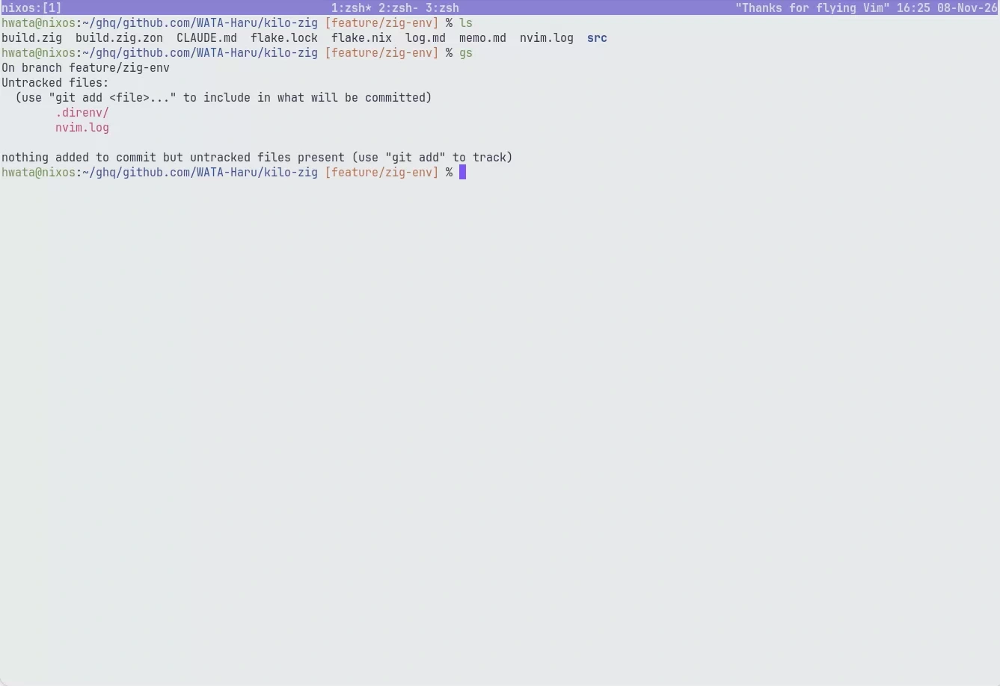
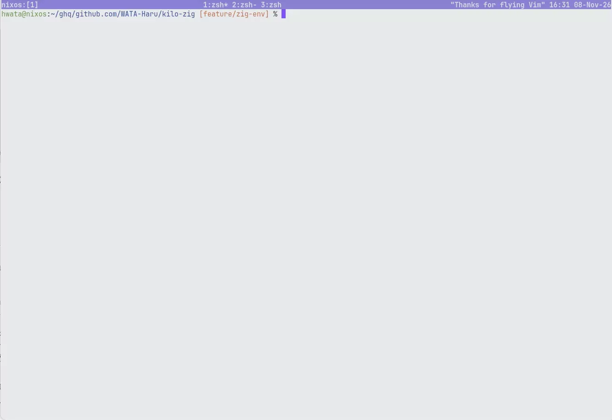

🎄この記事は bitA Tech Blog Advent Calendar 2026の1日目の記事です。
<!-- textlint-disable ja-technical-writing/no-doubled-joshi -->
自分が使っているツールの中で、見た目も機能も最高のツールを3つ紹介します。<!-- textlint-enable ja-technical-writing/no-doubled-joshi -->
<!-- textlint-disable ja-technical-writing/ja-no-mixed-period -->見た目が最高のツールでテンションをぶち上げていきましょう🔥<!-- textlint-enable ja-technical-writing/ja-no-mixed-period -->

## Ghostty

@[card](https://ghostty.org/docs)

### 見た目

<!-- textlint-disable ja-technical-writing/ja-no-mixed-period -->描画が非常に美しいです✨<!-- textlint-enable ja-technical-writing/ja-no-mixed-period -->
[bat](https://github.com/sharkdp/bat) の見た目も素晴らしいですね。



画像の表示にも対応しています。



### 採用理由

- 画面の描画が美しい
- `~/.config/ghostty/config`ですべて設定できる
- デフォルトの設定で十分使いやすい

参考までに、筆者の設定ファイルは14行しかありません。それほどデフォルト設定が素晴らしいです。

```sh: ~/.config/ghostty/config
theme=Iceberg Light

font-feature = "-calt"
font-feature = "-dlig"
font-feature = "-liga"

cursor-style=block
cursor-style-blink=false
mouse-hide-while-typing

font-size=10.3
keybind = performable:ctrl+c=copy_to_clipboard
keybind = ctrl+v=paste_from_clipboard
cursor-color = "#8060FF"
```

## tmux

@[card](https://github.com/tmux/tmux)

### 見た目

画面の分割・複製


マウスを使わずにターミナル出力をコピー


セッションの保持


### 採用理由

- **SSH接続が切れたあともセッションが保持できる**
- 画面を分割・複製できる

SSHで開発するようになってから手放せなくなりました。開発途中に何らかの原因でSSH接続が切れても、接続先のサーバーにはセッションがそのまま残ります。これにより、再度ディレクトリを移動したり、ファイルを開き直したりする必要がありません。

使ってみたくなった方には、以下の記事がおすすめです。

- [アニメーションで学ぶtmux入門 ～精選10機能～](https://qiita.com/KoyanagiHitoshi/items/318d4b8ef3b4e5b87390#%E3%83%90%E3%83%BC%E3%82%B8%E3%83%A7%E3%83%B3)
- [tmuxチートシート](https://qiita.com/nmrmsys/items/03f97f5eabec18a3a18b)

筆者の設定はこちらです。`prefix`キーは`Ctrl+f`にしています。ステータスバーもカスタマイズしました。
@[card](https://github.com/WATA-Haru/dotfiles/blob/main/dot_config/tmux/tmux.conf)

## Neovim

@[card](https://neovim.io/)

### 見た目



好きなプラグインの1つである[mini.files](https://github.com/nvim-mini/mini.files)では、vimでバッファを編集する感覚でディレクトリやファイルのコピー、リネーム、削除が可能です。


ファジーファインダーである[fzf.vim](https://github.com/junegunn/fzf.vim)も好きです。


### 採用理由

- **愛**
- マウスを使わずに操作できるから
- 軽量だから
- カスタマイズが楽しいから

<!-- textlint-disable ja-technical-writing/ja-no-weak-phrase -->ハマる人はとことんハマるエディタです。<!-- textlint-enable ja-technical-writing/ja-no-weak-phrase -->以前は好きでなければ正直割に合いませんでしたが、最近はAIによる支援もあるため、気軽に設定できます。

興味を持った方には、以下の記事がおすすめです。
筆者も以下の記事を参考にして少し改造した設定を使っています。
@[card](https://zenn.dev/kawarimidoll/books/6064bf6f193b51)

## 終わりに

<!-- textlint-disable ja-technical-writing/ja-no-mixed-period -->ぜひ、あなただけの誰よりもかっこいい開発環境を作ってみてください💪<!-- textlint-enable ja-technical-writing/ja-no-mixed-period -->
今回紹介した筆者のdotfilesはこちらです。
@[card](https://github.com/WATA-Haru/dotfiles)
